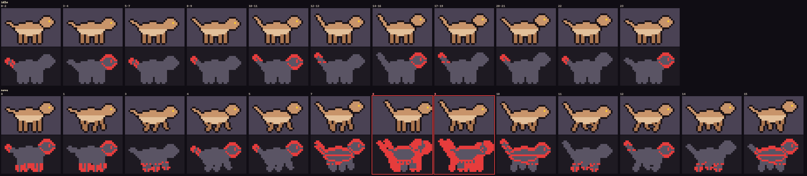
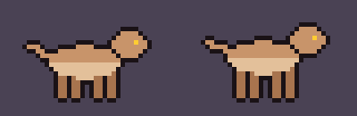
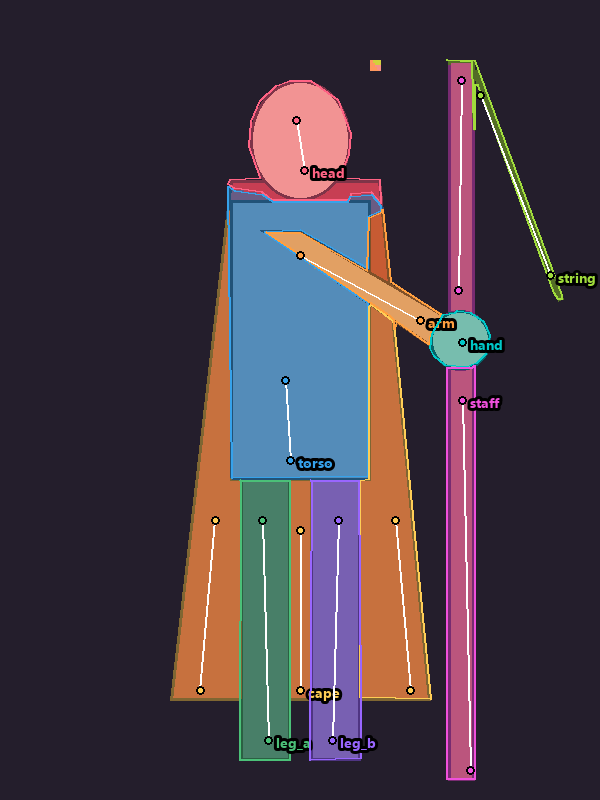

# Limberpix

[](https://github.com/therwn/limberpix/actions/workflows/selftest.yml)
[](LICENSE)

Two Claude Code skills for pixel-art sprite animation:

- **pixel-animate** is a method for animating a creature from one approved drawing (idle, walk, attack) so it
  moves like a living thing and still looks like its drawing. It comes with `body_parts.py`, which cuts the drawing
  into rig parts along its own ink lines.
- **pixel-anim-check** is a measured check that runs before an animation is shown to anyone. It catches specks,
  a lost eye, open outlines, feet leaving the ground, pops, texture shimmer, choppy or lurching cadence, 1-px ticks,
  a frozen head and more. It writes a contact sheet and a GIF so the result can be looked at by eye.

Both work with any engine or art tool. The scripts need only Python, numpy and Pillow.

## What it looks like

A clean walker passes with 0 faults. The same walker with one frame knocked 4 px sideways fails:

| Contact sheet of the broken walk (changed pixels in red, faulted frames outlined) | The clean walker's check GIF (idle and move) |
|---|---|
|  |  |

`body_parts.py` cuts a drawing into parts from a few rough bones placed by eye:



All three images were made by running the tools on the files in [`examples/`](examples). See
[Sample output, explained](#sample-output-explained).

## Requirements

- Python 3.8 or newer (CI runs 3.8 on Ubuntu 22.04, and 3.9 and 3.12 on Ubuntu and Windows)
- numpy >= 1.21 (1.x and 2.x) and Pillow >= 9 (`pip install -r requirements.txt`)
- Claude Code, if you want Claude to use the skills. The scripts also run on their own.

## Install

> **Not yet published.** Until the `therwn/limberpix` repository and its v0.1.0 release are public, the GitHub
> commands below (and the badge above) do not resolve. Meanwhile, install from a local copy of this folder:
> `/plugin marketplace add <path to this folder>`, then `/plugin install limberpix@limberpix`.

**1. As a Claude Code plugin (recommended).** Inside Claude Code:

```
/plugin marketplace add therwn/limberpix
/plugin install limberpix@limberpix
```

Plugin skills are namespaced, so they show up as `limberpix:pixel-animate` and `limberpix:pixel-anim-check`.

**2. As plain skills.** Copy the skill folders into your personal skills folder, or into one project's:

```bash
git clone https://github.com/therwn/limberpix
cp -r limberpix/skills/* ~/.claude/skills/          # every project
# or: cp -r limberpix/skills/* <your project>/.claude/skills/
```

On Windows PowerShell: `Copy-Item -Recurse limberpix\skills\* $HOME\.claude\skills\`.

**3. Only the command-line tools.** Clone the repo and run the scripts with Python:

```bash
git clone https://github.com/therwn/limberpix
cd limberpix
python -m pip install -r requirements.txt
python skills/pixel-anim-check/pixel_anim_check.py --selftest
```

## Quick start

Run these from the repo root. Each command is one line, so it pastes into bash, PowerShell and cmd alike.

Check the example walker (frames are 34 px wide, the eye is `#ffcc33`):

```
python skills/pixel-anim-check/pixel_anim_check.py --loop idle=examples/walker_idle.png --loop move=examples/walker_move.png --frame 34 --eye "#ffcc33" --out out --name walker
```

It prints `walker: 0 fault(s)`, exits 0, and writes `out/walker_check.png` and `out/walker_check.gif`. Now run
the broken one:

```
python skills/pixel-anim-check/pixel_anim_check.py --loop idle=examples/walker_idle.png --loop move=examples/broken_move.png --frame 34 --eye "#ffcc33" --out out --name broken
```

It prints two `jump` faults on frame 8 and exits 1. Then the example flier, which casts a ground shadow:

```
python skills/pixel-anim-check/pixel_anim_check.py --loop idle=examples/flier_idle.png --loop move=examples/flier_move.png --frame 30 --eye "#ffcc33" --flier --shadow "#2b2430" --out out --name flier
```

It prints `flier: 0 fault(s)`. A flier's shadow colours must be given with `--shadow`, or the shadow counts as a
stray piece: without it the same run reports 41 `apart` faults.

Cut the example figure into parts, and take the automatic first look at it:

```
python skills/pixel-animate/body_parts.py examples/figure.png examples/marks.json --out out --name figure
python skills/pixel-animate/creature_map.py examples/figure.png --out out
```

The first writes `out/figure_parts.png` (the overlay above) and exits 0. The second reads the figure, a person with
a staff and a cape, as `serpent or worm`: a wrong plan, which is the limitation described under
[Limitations](#limitations).

In Claude Code you do not need the commands. Ask for the work, for example "animate this fox's idle and walk from
fox.png", or "check walk.png before I put it in the game". Claude loads the right skill, runs the scripts and looks at
the pictures they write.

## The skills

### pixel-animate

**What it does.** It is a written method, not a generator. It covers how to plan the loops before drawing, how to cut
the reference into parts (a rig), and how to pose the parts at full size and shrink every frame on one fixed grid.
It also sets out the motion principles that read in pixels: whole-pixel steps, holds against crawl, the moving hold,
lift without ticks, wings, legs, snakes, heads, chains and seams. A section covers sprite sheets with few drawings
(hand-drawn or AI-made), and every loop ends with pixel-anim-check.

**When Claude uses it.** When you ask it to make or remake a sprite animation, to choose how a creature attacks, or
when you say an animation looks stiff, broken, or unlike its drawing.

**Tools in the skill folder** (commands from the repo root):

```
python skills/pixel-animate/body_parts.py <drawing.png> --grid [--step 50] [--out DIR] [--name NAME]
python skills/pixel-animate/body_parts.py <drawing.png> <landmarks.json> [--out DIR] [--name NAME]
python skills/pixel-animate/body_parts.py --selftest
```

- `--grid` writes `<name>_grid.png`, a copy of the drawing with a labelled grid. Use it to read coordinates for the
  landmarks.
- With a landmarks file it cuts the drawing into parts. Each part has a rough *bone* down its middle, placed by eye.
  A bone is 1 to 4 points. A `null` in a bone starts a new piece: use it for a part seen in pieces (a staff above
  and below the hand, a cape on both sides of the legs). Each piece is 1 to 4 points. `examples/marks.json` is a
  working landmarks file for `examples/figure.png` and uses both.
- The cut follows the drawing's own ink lines and colour edges. It writes `<name>_parts.png` (the overlay above),
  `<name>_patches.png`, `<name>_parts.json` (per part: kind, parent, pivot, area share, bounding box, outline
  polygon) and `<name>_labels.png` (one grey level per part, for code that cuts by it). `--out` defaults to the
  drawing's folder and is made if missing; `--name` to the drawing's file name.
- It prints one line per part. Its `pieces` count is every fragment of the part, however small, and is no fault by
  itself: the example prints `pieces 5` for the staff, which is broken by `null` on purpose and drawn behind the
  hand. A `CHECK:` line is printed only for a real problem: a bone point off the figure, a bone wholly off it, a
  part with no pixels, a part whose second piece is 12 px or more *and* 8 % or more of the part (parts with
  `null`-broken bones are not judged), a bone that ended up in a neighbour, a part mostly of colours not under its
  bone, and figure pixels no part reached.
- Exit code: 0 a clean cut (or the grid written), 1 a cut with `CHECK:` lines, 2 a usage error.

```
python skills/pixel-animate/creature_map.py <drawing.png> [--eye #rrggbb | --eye-at X,Y] [--floating] [--out DIR] [--name NAME]
python skills/pixel-animate/creature_map.py --selftest
```

- `creature_map.py` guesses a body plan from the silhouette alone: spine, head end, limbs and pivots. It is a
  **first look only**. See [Limitations](#limitations). It takes one drawing, not a strip of frames.
- Exit code: 0 done, 1 no body found in the drawing, 2 a usage error.

### pixel-anim-check

**What it does.** It runs `pixel_anim_check.py` on every loop of a creature and reports faults by name. It also
prints two read-outs, the per-step change list and the eye's row track, and writes a contact sheet and a GIF. The
skill then has Claude inspect them by eye for what numbers cannot see: likeness, seams, life in every part, and
rhythm.

**When Claude uses it.** Whenever a sprite animation is made or changed, and before one is shown to anyone.

```
python skills/pixel-anim-check/pixel_anim_check.py --loop NAME=SRC [--loop NAME=SRC ...] [options]
python skills/pixel-anim-check/pixel_anim_check.py --selftest
python skills/pixel-anim-check/pixel_anim_check.py --help
```

**Exit code:** 0 no fault, 1 one fault or more, 2 a usage error (a bad option, a missing file, a strip that does not
cut into whole frames).

| Option | Meaning |
|---|---|
| `--loop NAME=SRC` | a loop: a horizontal strip PNG, a folder of frame PNGs, or a GIF |
| `--frame W` / `--frames N` | a strip's frame width, or its frame count (with neither, square frames; a strip that does not cut evenly is refused) |
| `--eye #rrggbb` | the eye's colour: checked on every frame, its row track printed |
| `--flier` | it flies: its shadow must not slide, its body height is read for ticks |
| `--shadow #hex,...` | a flier's ground-shadow colours (required for a flier with a shadow) |
| `--ink #hex,...` | the outline colours (default: every colour darker than lightness 40) |
| `--effects #hex,...` | colours of effects drawn apart from the figure on purpose |
| `--allow LOOP=N` | pieces up to N px may sit apart from the figure in that loop (a thrown coin) |
| `--glows-eye LOOP` | the eye is recoloured by a glow in that loop, so it is not checked there |
| `--idle NAME --move NAME` | which loops are the rest and the travel loop (default `idle`, `move`) |
| `--legless` | a snake or slug: no body rise asked of its move |
| `--facing right\|left` | which way the head faces (default right) |
| `--fps N` | the rate the game plays the loops at (default 30; a decimal is allowed) |
| `--out DIR` | where `<name>_check.png` and `<name>_check.gif` go (default `.`, the current folder) |
| `--name NAME` | the stem of the written files (default `anim`) |

Colours are `#rrggbb` in any case, the `#` optional. Every frame of every loop must be the same size, with the
figure kept in place rather than trimmed per frame.

- **A frame folder** is read in file-name order, so zero-pad the numbers (`f00.png`, `f01.png`, ...): otherwise
  `f10.png` comes before `f2.png`. `--frame` and `--frames` do not apply to it.
- **A GIF** is read at its own timing. Pillow, Aseprite and most exporters store a held pose as one image with a
  longer duration, so each image is held for its duration at `--fps` (130 ms at 30 fps is 4 frames). To judge one
  image per game frame regardless of its duration, give a strip or a frame folder instead.

**Faults:** `size`, `empty`, `apart`, `eye`, `outline`, `ground`, `jump`, `still`, `shimmer`, `frozen`, `stiff`,
`choppy`, `uneven`, `lurch`, `snap`, `tick`, `hop`, `vanish`, `shallow`, `reshape`. Each one, with its usual cause
and fix, is in the table in [`skills/pixel-anim-check/SKILL.md`](skills/pixel-anim-check/SKILL.md).

**From code.** A project with its own pipeline can skip the PNGs and import the module:

```python
import pixel_anim_check as pac

loops = {"idle": pac.load("idle.png", frame=34), "move": pac.load("walk.gif", fps=30)}
spec = pac.Spec(eye="#ffcc33")             # also: flier=True, shadow={...}, gait=False (= --legless), fps=12, ...
warns = []
faults = pac.check(loops, spec, warns)     # fault lines; warnings go into warns
for line in pac.tracks(loops, spec):       # the two read-outs
    print(line)
pac.sheet(loops, "fox_check.png", faults=faults)   # the contact sheet, faulted frames outlined
pac.gif(loops, "fox_check.gif", fps=30)
```

A frame is a list of rows, and each pixel is a colour key or `None` (transparent). `load` gives `"#rrggbb"` keys.
If your keys are something else, pass two functions to `Spec`, and `rgb` to `sheet` and `gif`:
`lum(key)` returns the key's luma, 0-255 (`0.299 r + 0.587 g + 0.114 b`; the outline default is under 40), and
`rgb(key)` returns `(r, g, b)`. For example, with `(r, g, b)` tuples as keys:

```python
spec = pac.Spec(eye=(255, 204, 51), lum=lambda c: 0.299 * c[0] + 0.587 * c[1] + 0.114 * c[2], rgb=lambda c: c)
pac.sheet(loops, "fox_check.png", rgb=spec.rgb)
```

Without them, non-hex keys raise a `TypeError`.

## Sample output, explained

The broken walker's run. The clean walker prints the same lines without the two faults, and its move reads `38 33`
where this one reads `99 102`:

```
broken: 2 fault(s)
  jump: move a change of 267 px against a mean of 74 (frame 8)
  jump: move[8] is knocked 4 px sideways out of step
  idle: steps 0 0 13 0 6 0 0 4 0 18 0 5 0 13 0 0 5 0 0 5 0 4 13 6 (% of the figure)
  idle: eye rows [(8, 7), (7, 4), (6, 9), (7, 4)]
  move: steps 33 13 13 19 18 13 16 99 102 10 13 18 18 13 16 37 (% of the figure)
  move: eye rows [(6, 1), (7, 1), (8, 2), (7, 1), (6, 2), (5, 1), (6, 1), (7, 1), (8, 2), (7, 1), (6, 2), (5, 1)]
```

- **Frame numbers are 0-based.** `move[8]` is the move's ninth frame. "(frame 8)" in a `jump` or `snap` is the
  change from frame 8 to frame 9.
- **Faults** come first, one per line, as `kind: where and how much`. Warnings, if any, are `warn:` lines. They point
  at things an action may do on purpose (a jaw opened in an attack). Look at them, but they do not count as faults.
- **The per-step change list** (`steps`) gives the share of the figure that changes from each frame to the next, with
  a 1-px bob forgiven. Its k-th number is the change from frame k to frame k+1 (the last one wraps to frame 0). Here
  `99 102` against neighbours of 10-20 is the frame knocked out and back. Other shapes to look for: a long run of
  zeros and then a big step (a dead stop, then a lurch), one doubled hold among even ones (a dropped update), and
  steps alternating big and small (a lurch).
- **The eye's row track** (`eye rows`) lists runs of `(row, frames)`. In the idle every level should last 4 or more
  frames at an extreme. A level reached for 2 or 3 frames and left again is a *tick*, the 1-px twitch that makes an
  idle look nervous.
- **The contact sheet** (`<name>_check.png`, above) shows each distinct pose zoomed (at most 12 a loop, spread over
  it, plus every pose a fault names). Each tile is labelled with the frames it holds: `5-7` is one pose held over
  frames 5 to 7. Under it, the pixels changed from the pose just before are drawn in red. The tiles of the frames a
  fault names are outlined in red: here frames 8 and 9, whose whole bodies light up red, once going out and once
  coming back.
- **The GIF** (`<name>_check.gif`) plays the loops side by side at `--fps`. Look at it zoomed and at 1x.

## Limitations

- **The thresholds are fitted, not derived.** `choppy`, `snap`, `tick`, `hop`, `vanish`, `shallow` and `reshape` were
  fitted to a private calibration set: 39 animated creatures, with 15 accept or reject judgements on them by one
  reviewer. That set is not included. No published source gives a pixel threshold for judder. Each function's
  docstring states its margins. Expect false alarms or misses on styles far from that set, and rerun your approved
  animations whenever you change a threshold.
- **The check does not judge taste.** It cannot see likeness, appeal or whether an attack reads. That is why the skill
  ends with a look by eye.
- **`creature_map.py` is a first look only.** It reads the silhouette, and a silhouette cannot tell a bow from an arm
  or a cape from a tail. On a second private set, 38 hand-drawn reference drawings (humanoids, quadrupeds, fliers,
  serpents, insects and others; not included), it got 13 body plans right and named most parts wrong. The example
  figure above comes out as a serpent. Use `body_parts.py`, with bones placed by eye, for the actual cut (it was
  looked at by eye on the same 38 drawings).
- **The method is written for side-view sprites** of creatures, from small pets to large beasts. Top-down and
  isometric sprites are not covered.
- **The scripts can be copied alone,** as the skills do, but `--selftest` needs its test file beside the script
  (`pixel_anim_selftest.py`, `body_parts_selftest.py`, `creature_map_selftest.py`).

## Development

```
python skills/pixel-anim-check/pixel_anim_selftest.py
python skills/pixel-animate/body_parts_selftest.py
python skills/pixel-animate/creature_map_selftest.py
python examples/make_examples.py --verify
```

`pixel_anim_selftest.py --verbose` also prints the numbers behind its special clean cases. `make_examples.py
--verify` checks the examples still match the selftests' creatures; without `--verify` it rewrites only the files
whose pixels differ. See [CONTRIBUTING.md](CONTRIBUTING.md). Changes are listed in [CHANGELOG.md](CHANGELOG.md).

## Licence

[MIT](LICENSE), copyright (c) 2026 therwn.
