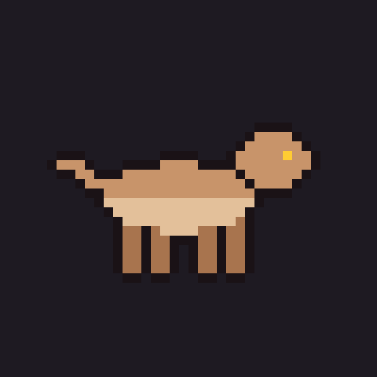
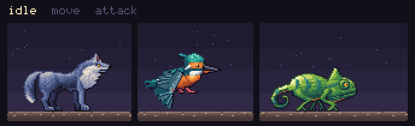
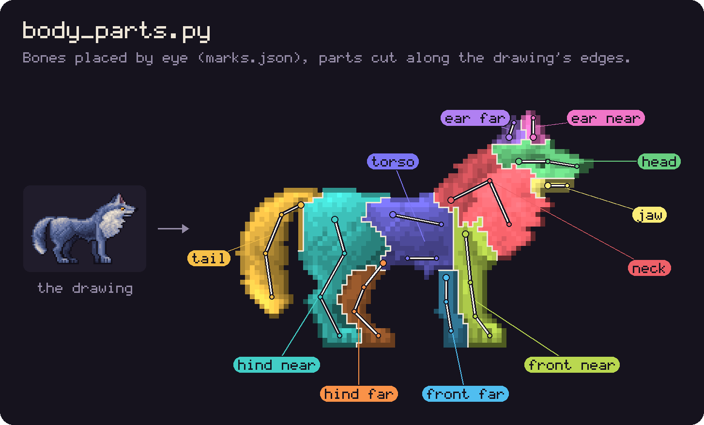
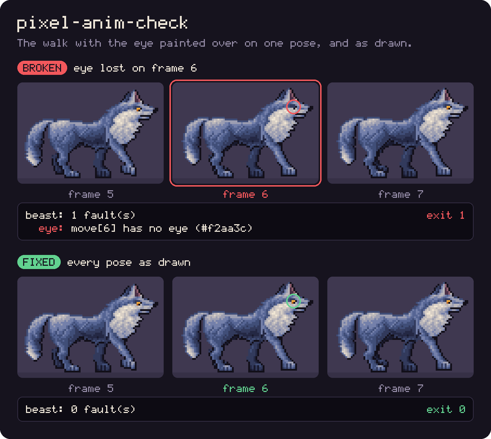

<p align="center">
  
</p>

<h1 align="center">Limberpix</h1>

<p align="center">
  <b>Two Claude Code skills for pixel-art sprite animation.</b><br>
  Animate a creature from one drawing, then check every loop for broken motion before anyone sees it.
</p>

<p align="center">
  <a href="https://github.com/therwn/limberpix/actions/workflows/selftest.yml"></a>
  <a href="LICENSE"></a>
  
  
</p>

<p align="center">
  
</p>

<p align="center">
  <sub>Three original creatures, each drawn once as data and animated from that drawing alone: an idle, a move over a
  road scrolling at the creature's own speed, and an attack. Sources in <a href="examples/showcase"><code>examples/showcase/</code></a>.</sub>
</p>

<p align="center">
  <a href="#try-it">Try it</a> ·
  <a href="#the-skills">The skills</a> ·
  <a href="#what-it-suits-and-what-it-does-not">Limits</a> ·
  <a href="#install">Install</a> ·
  <a href="docs/usage.md">Docs</a>
</p>

---

## At a glance

| | [pixel-animate](skills/pixel-animate/SKILL.md) | [pixel-anim-check](skills/pixel-anim-check/SKILL.md) |
|---|---|---|
| **What it is** | A written method, with a part cutter. Not a generator | A measuring script, and how to read what it prints |
| **You give it** | One approved drawing of a side-view creature | Sprite strips, frame folders or GIFs, and the eye colour |
| **You get** | An idle, a move and an action posed from the drawing's own pixels | Named faults, a contact sheet and a GIF to look at |
| **Scripts** | `body_parts.py`, `shrink.py`, `creature_map.py` | `pixel_anim_check.py` |
| **Ask Claude** | "animate this fox's idle and walk from fox.png" | "check walk.png before I put it in the game" |

## Try it

From the repo root, on the files in [`examples/`](examples). Python 3.8+ with numpy and Pillow
(`python -m pip install -r requirements.txt`).

```sh
# a clean walk: prints "walker: 0 fault(s)", exits 0
python skills/pixel-anim-check/pixel_anim_check.py --loop idle=examples/walker_idle.png --loop move=examples/walker_move.png --frame 34 --eye "#ffcc33" --out out --name walker

# the same walk with one pose knocked sideways: two "jump" faults around frame 8, exits 1
python skills/pixel-anim-check/pixel_anim_check.py --loop idle=examples/walker_idle.png --loop move=examples/broken_move.png --frame 34 --eye "#ffcc33" --out out --name broken

# cut a drawing into parts along its own ink and colour edges: writes out/figure_parts.png
python skills/pixel-animate/body_parts.py examples/figure.png examples/marks.json --out out --name figure
```

Each check also writes a contact sheet and a GIF to `out/`.

## The skills

### pixel-animate

A written method, not a generator: cut the approved drawing into parts, pose them at full size, shrink every frame on
one fixed grid, with the motion rules that read in pixels (whole-pixel steps, holds, wings, legs, tails, heads).
Claude uses it to make or remake a sprite animation, or when one looks stiff, broken or unlike its drawing.
`body_parts.py` cuts the drawing into parts, and `shrink.py` brings a frame posed on a large painted reference down
to game size (a drawing already at game size is posed as it is).

<p align="center">
  
</p>

### pixel-anim-check

Measures every loop and names its faults. It writes a contact sheet and a GIF for a look by eye. Claude uses it
whenever an animation is made or changed, and before one is shown.

<p align="center">
  
</p>

<details>
<summary><b>What it looks for</b></summary>

<br>

| Group | Faults (the run fails) | Warnings (look at them) |
|---|---|---|
| **The drawing** | a frame of another size, stray specks, a lost eye, open outlines, colours off the palette, lost marks | orphan pixels, doubled outlines, blends, drift from the approved drawing |
| **Standing and moving** | feet off the ground, a hop off the contact, a frozen head, a body that never rises in the walk, shallow wing beats | sliding feet, the walk's bob, a head stepping alone, part volume and lag, a torso split in bands |
| **Timing** | choppy or uneven holds, a dead stop then a burst, 1-px ticks, a pop or a pose knocked sideways, a part that vanishes | a repeated pose at the loop's seam, outline boil |
| **Texture and face** | shimmer, a redrawn face | |
| **Actions** | | anticipation, strike, recovery, jumps and landings |
| **Redrawn frames** (`--style redrawn`) | slow and stepped motion, a mark gone in some poses, a broken outline, small marks missing | |

Every fault's meaning and its usual fix: [skills/pixel-anim-check/SKILL.md](skills/pixel-anim-check/SKILL.md).

</details>

## What it suits, and what it does not

| It suits | It does not |
|---|---|
| A rigid body with limbs, a tail or wings: the showcase's wolf, bird and lizard | Cloth that changes shape, a body that turns, a pose the drawing does not show |
| Keeping the approved drawing's exact pixels and colours through every frame | The look of frames redrawn one by one by hand or by a model |
| Finding defects a script can find: specks, a lost eye, a part come loose, a colour off the palette | Saying whether the motion is good |

- **A cut-out cannot show what the drawing does not show.** In a test against a hand-drawn sheet of a cloaked wizard,
  16 % of each idle frame's pixels (30 % at the deepest pose) matched no part of the first frame however it was
  shifted, and thirteen parts fitted to every frame by pixel difference still left 29-39 % of the pixels wrong at the
  deepest poses. Three cut-out versions were judged worse than the hand-drawn loops by the viewer who played them.
- **0 faults is not a verdict on the motion.** In that test the fault count did not follow the viewer's ranking, and
  the hand-drawn idle the viewer accepted gets a fault the rejected cut-out does not. The check finds listed
  defects; whoever plays the loop judges it.
- **The thresholds are fitted, not derived:** to a private set of 39 animated creatures judged by one reviewer.
  Expect false alarms and misses on styles far from it.

The full list is in [docs/usage.md](docs/usage.md#limitations).

## Install

**Plugin** (inside Claude Code):

```
/plugin marketplace add therwn/limberpix
/plugin install limberpix@limberpix
```

**Plain skills:** copy `skills/*` into `~/.claude/skills/` (or a project's `.claude/skills/`). A copy does not
update itself: copy again after every pull, or a session runs the old rules and the old checks.

**Command-line tools only:** `git clone https://github.com/therwn/limberpix`, then run the scripts with Python.

**Requirements:** Python 3.8+ with numpy and Pillow (`python -m pip install -r requirements.txt`); Claude Code to use
the skills. The skills run their scripts with `python -I`, which does not see a `pip install --user`: install the
two in a virtual environment or for the whole system (see [Troubleshooting](docs/usage.md#troubleshooting)).

## Docs

| | |
|---|---|
| [docs/usage.md](docs/usage.md) | Every option, the sample output explained, use from code, limitations, troubleshooting, development |
| [pixel-animate/SKILL.md](skills/pixel-animate/SKILL.md) | The method Claude follows, step by step |
| [pixel-animate/MOTION.md](skills/pixel-animate/MOTION.md) | The motion rules: steps, cadence, wings, gaits, heads, attacks |
| [pixel-anim-check/SKILL.md](skills/pixel-anim-check/SKILL.md) | Every fault, what it means and its usual fix |
| [examples/showcase/](examples/showcase) | The three creatures: drawing, rig, loops and their check options |
| [CHANGELOG.md](CHANGELOG.md) · [CONTRIBUTING.md](CONTRIBUTING.md) | Changes, and how to change it |

## Licence

[MIT](LICENSE), copyright (c) 2026 therwn.
