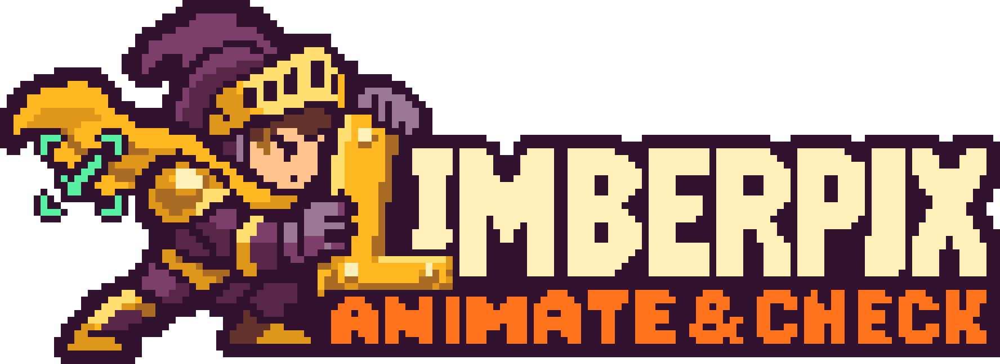
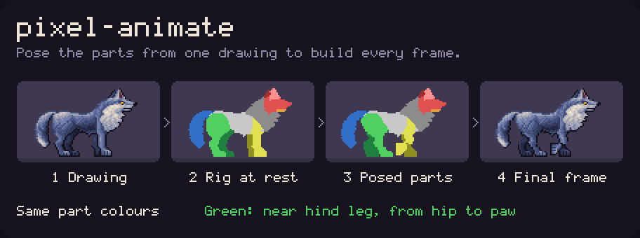
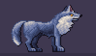
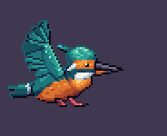
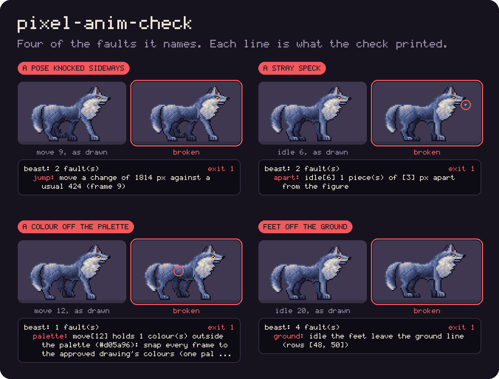
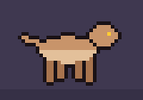
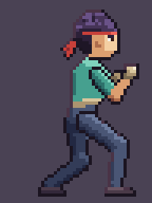

<h1 align="center">
  
</h1>

<p align="center">
  <b>Two agent skills for pixel-art sprite animation, for Claude Code and Codex.</b><br>
  Animate a creature from one drawing, then check every loop for broken motion before anyone sees it.
</p>

<p align="center">
  <a href="https://github.com/therwn/limberpix/actions/workflows/selftest.yml"></a>
  <a href="LICENSE"></a>
  
  
  
</p>

<p align="center">
  
</p>

<p align="center">
  <a href="#what-it-does-in-pictures">In pictures</a> ·
  <a href="#try-it">Try it</a> ·
  <a href="#examples">Examples</a> ·
  <a href="#what-it-suits-and-what-it-does-not">Limits</a> ·
  <a href="#install">Install</a> ·
  <a href="docs/usage.md">Docs</a>
</p>

---

## What it does, in pictures

### 1. pixel-animate: pose parts of a drawing

Cut the approved drawing into parts and pose them over the loop. Draw extra keys when a pose needs a new view of a
part, such as the bird's turning head and folded wings. The wolf animation starts from layers prepared by hand.

<p align="center">
  
</p>

The two middle tiles use the same rig colours. The green shape includes the near hind leg's thigh at the hip.
See the [four steps as a still](docs/img/gallery/pipeline.png) and the
[measured cut from body_parts.py](docs/img/parts.png). The [cut idle example](examples/README.md#cut-idle) builds a
checked animation from a flat PNG and bone marks using the exported label mask.

### 2. Three loops for each creature

Each creature has a layered drawing and an idle, a move and an attack. The bird also uses separately drawn head and
wing poses.
Sources and check options are in [`examples/showcase/`](examples/showcase).

| | idle | move | attack |
|---|:---:|:---:|:---:|
| **Wolf** |  |  |  |
| **Bird** |  |  |  |
| **Lizard** |  |  |  |

### 3. pixel-anim-check: it names what is broken

Each case below was made by breaking the wolf's own frames, then run through the real check. The line under each pair
is what it printed.

<p align="center">
  
</p>

<details>
<summary><b>Everything it looks for</b></summary>

<br>

| Group | Faults (the run fails) | Warnings (look at them) |
|---|---|---|
| **The drawing** | a frame of another size, stray specks, a lost eye, open outlines, colours off the palette, lost marks | orphan pixels, doubled outlines, blends, drift from the approved drawing |
| **Standing and moving** | feet off the ground, a hop off the contact, a frozen head, a body that never rises in the walk, shallow wing beats | sliding feet, the walk's bob, a head stepping alone, part volume and lag, a torso split in bands |
| **Timing** | choppy or uneven holds, a dead stop then a burst, 1-px ticks, a pop or a pose knocked sideways, a part that vanishes | a repeated pose at the loop's seam, outline boil |
| **Texture and face** | shimmer, a redrawn face | |
| **Actions** | | anticipation, strike, recovery, jumps and landings |
| **Redrawn frames** (`--style redrawn`) | a mark gone in some poses, a broken outline, small marks missing | slow and stepped motion, and every other motion check |

Every fault's meaning and its usual fix: [skills/pixel-anim-check/SKILL.md](skills/pixel-anim-check/SKILL.md).

</details>

## At a glance

| | [pixel-animate](skills/pixel-animate/SKILL.md) | [pixel-anim-check](skills/pixel-anim-check/SKILL.md) |
|---|---|---|
| **What it is** | A written method, with a part cutter. Not a generator | A measuring script, and how to read what it prints |
| **You give it** | One approved drawing of a side-view creature | Sprite strips, frame folders or GIFs, and the eye colour |
| **You get** | An idle, a move and an action posed from the drawing's own pixels | Named faults, a contact sheet and a GIF to look at |
| **Scripts** | `body_parts.py`, `shrink.py`, `creature_map.py` | `pixel_anim_check.py`, `repair_sheet.py` |
| **Ask the agent** | "animate this fox's idle and walk from fox.png" | "check walk.png before I put it in the game" |

## Try it

From the repo root, on the files in [`examples/`](examples). Python 3.11+ with NumPy and Pillow
(`python -m pip install -r requirements.txt`).

```sh
# a clean walk: prints "walker: 0 fault(s)", exits 0
python skills/pixel-anim-check/pixel_anim_check.py --loop idle=examples/walker_idle.png --loop move=examples/walker_move.png --frame 34 --eye "#ffcc33" --out out --name walker

# the same walk with one pose knocked sideways: two "jump" faults around frame 8, exits 1
python skills/pixel-anim-check/pixel_anim_check.py --loop idle=examples/walker_idle.png --loop move=examples/broken_move.png --frame 34 --eye "#ffcc33" --out out --name broken

# cut a drawing along its own ink and colour edges; find the files in out/figure_parts_manifest.json
python skills/pixel-animate/body_parts.py examples/figure.png examples/marks.json --out out --name figure
```

Each check also writes a contact sheet and a GIF to `out/`.

## Examples

| | What it is | Where |
|---|---|---|
|  | **Walker and flier.** The two small creatures the selftest draws, and one walk broken on purpose. The quick start above runs on them | [`examples/`](examples/README.md#walker-and-flier) |
|  | **Fighter.** A two-legged figure drawn at game size and posed there, with its part strip, palette and drawing given to the check | [`examples/fighter/`](examples/README.md#fighter) |
|  | **Showcase.** The wolf, the bird and the lizard: drawing, bones, rig, three loops each and the full check command | [`examples/showcase/`](examples/README.md#showcase) |

Every example, with its pictures and the commands that rebuild it: [examples/README.md](examples/README.md).

## What it suits, and what it does not

| It suits | It does not |
|---|---|
| A rigid body with limbs, a tail or wings: the showcase's wolf, bird and lizard | Cloth that changes shape, a body that turns, a pose the drawing does not show |
| Keeping the approved drawing's exact pixels and colours through every frame | The look of frames redrawn one by one by hand or by a model |
| Finding defects a script can find: specks, a lost eye, a part come loose, a colour off the palette | Saying whether the motion is good |

- **A cut-out cannot show what the drawing does not show.** In a test against a hand-drawn sheet of a cloaked wizard,
  16 % of each idle frame's pixels (30 % at the deepest pose) matched no part of the first frame however it was
  shifted, and thirteen parts fitted to every frame by pixel difference still left 29-39 % of the pixels wrong at the
  deepest poses. Three cut-out versions were judged worse than the hand-drawn loops by the viewer who played them.
- **0 faults is not a verdict on the motion.** In that test the fault count did not follow the viewer's ranking, and
  the hand-drawn idle the viewer accepted gets a fault the rejected cut-out does not. The check finds listed
  defects; whoever plays the loop judges it.
- **The thresholds are fitted, not derived:** to a private set of 39 animated creatures judged by one reviewer.
  Expect false alarms and misses on styles far from it.

The full list is in [docs/usage.md](docs/usage.md#limitations).

## Install

**Claude Code** (plugin):

```
/plugin marketplace add therwn/limberpix
/plugin install limberpix@limberpix
```

**Codex:** ask it to install the two skills from this repo with its skill installer, then start a new turn:

```
$skill-installer install https://github.com/therwn/limberpix/tree/main/skills/pixel-animate and https://github.com/therwn/limberpix/tree/main/skills/pixel-anim-check
```

Then call them by name: `$pixel-animate`, `$pixel-anim-check`.

**Plain skills, any agent:** copy `skills/*` into the agent's skills folder (`~/.claude/skills/` for Claude Code,
`~/.codex/skills/` for Codex, or a project's `.claude/skills/`). A copy does not update itself: copy again after
every pull, or a session runs the old rules and the old checks.

**Command-line tools only:** `git clone https://github.com/therwn/limberpix`, then run the scripts with Python.

**Requirements:** Python 3.11+ with NumPy and Pillow (`python -m pip install -r requirements.txt`). The skills run
their scripts with `python -I`, which does not see a `pip install --user`: install the two in a virtual environment
or for the whole system (see [Troubleshooting](docs/usage.md#troubleshooting)).

## Docs

| | |
|---|---|
| [docs/usage.md](docs/usage.md) | Every option, the sample output explained, use from code, limitations, troubleshooting, development |
| [examples/README.md](examples/README.md) | Every example with its pictures and commands |
| [pixel-animate/SKILL.md](skills/pixel-animate/SKILL.md) | The method the agent follows, step by step |
| [pixel-animate/MOTION.md](skills/pixel-animate/MOTION.md) | The motion rules: steps, cadence, wings, gaits, heads, attacks |
| [pixel-anim-check/SKILL.md](skills/pixel-anim-check/SKILL.md) | Every fault, what it means and its usual fix |
| [docs/ROADMAP.md](docs/ROADMAP.md) | Where it is going: finding and repairing what generated sheets lose |
| [CHANGELOG.md](CHANGELOG.md) · [CONTRIBUTING.md](CONTRIBUTING.md) | Changes, and how to change it |

## Licence

The software and its documentation are available under the [MIT License](LICENSE), copyright (c) 2026 therwn.
The [brand usage policy](docs/brand/LICENSE.md) applies to the Limberpix name and the logo artwork.
