# Examples

Everything here is drawn by code in this repo, so each picture can be rebuilt and each number checked. The loops
play at 30 fps. Run the commands from the repo root.

- [Walker and flier](#walker-and-flier): the two small creatures the selftest draws, and a walk broken on purpose
- [Figure](#figure): a drawing and its bones, for `body_parts.py`
- [Cut idle](#cut-idle) starts with a flat PNG and bones and poses the exported layers
- [Fighter](#fighter): a two-legged figure drawn and posed at game size
- [Showcase](#showcase): the wolf, the bird and the lizard, three loops each

## Walker and flier

Small creatures drawn by [`make_examples.py`](make_examples.py), the same ones `pixel_anim_selftest.py` tests the
check on. The walker's frames are 34 px wide, the flier's 30 px; both have the eye `#ffcc33`.

| walker, idle | walker, move | the move, broken | flier, idle | flier, move |
|:---:|:---:|:---:|:---:|:---:|
| 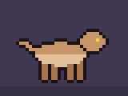 | 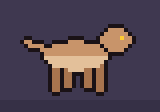 | 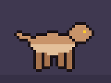 | 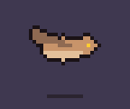 | 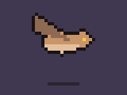 |
| `walker_idle.png` | `walker_move.png` | `broken_move.png` | `flier_idle.png` | `flier_move.png` |

```sh
# the clean walker: "walker: 0 fault(s)", exit 0
python skills/pixel-anim-check/pixel_anim_check.py --loop idle=examples/walker_idle.png --loop move=examples/walker_move.png --frame 34 --eye "#ffcc33" --out out --name walker

# one move pose knocked 4 px sideways: two "jump" faults around frame 8, exit 1
python skills/pixel-anim-check/pixel_anim_check.py --loop idle=examples/walker_idle.png --loop move=examples/broken_move.png --frame 34 --eye "#ffcc33" --out out --name broken

# the flier casts a ground shadow, named with --shadow: "flier: 0 fault(s)"
python skills/pixel-anim-check/pixel_anim_check.py --loop idle=examples/flier_idle.png --loop move=examples/flier_move.png --frame 30 --eye "#ffcc33" --flier --shadow "#2b2430" --out out --name flier
```

Each run prints the folder holding the contact sheet and GIF. The `png` and `gif` paths in
`out/<name>_check.json` point to the latest complete pair. Without `--shadow`, the checker counts the flier's shadow
as a stray piece.

## Figure

[`figure.png`](figure.png) is a person with a staff and a cape, and [`marks.json`](marks.json) holds its bones:
a rough line down the middle of each part, placed by eye. `body_parts.py` grows each part from its bone along the
drawing's own ink and colour edges.

<p>
  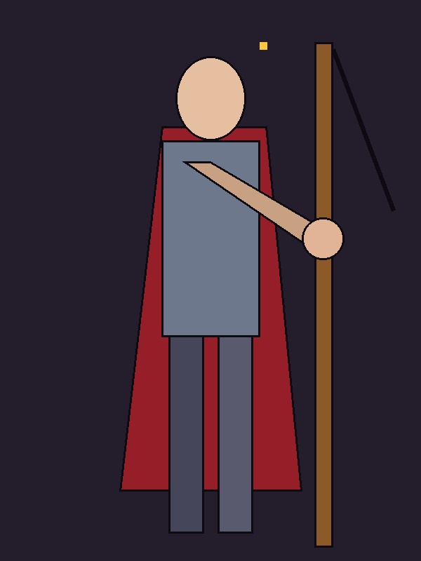
</p>

```sh
python skills/pixel-animate/body_parts.py examples/figure.png examples/marks.json --out out --name figure
```

It writes `out/figure_parts_manifest.json`. Its paths, relative to `out`, locate `figure_parts.png` (the tinted
overlay), `figure_patches.png`, `figure_labels.png` (the cutting mask) and `figure_parts.json`.

## Cut idle

Run `python -I examples/cut_idle.py --out out/cut-idle` to build and check a hovering beacon. The script writes
`beacon.png` and `beacon-marks.json`, runs `body_parts.py`, and resolves `beacon_labels.png` and `beacon_parts.json`
from the cut manifest. It builds `beacon_idle.png` from the two extracted layers and runs the checker,
which reports zero faults and prints the preview directory.

## Fighter

[`fighter/`](fighter) is a fighter in a stance, drawn at game size (48x64) from a skeleton by
[`fighter.py`](fighter/fighter.py). Its idle is one bounce of 8 poses: the torso moves on every pose, the limbs
further from the body move more, the head holds at the turns and the headband's tails come a pose behind it.

| the drawing | the idle | the idle as parts |
|:---:|:---:|:---:|
| 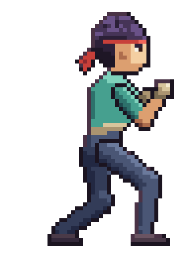 | 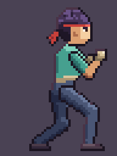 | 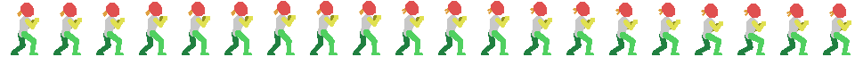 |
| `fighter_art_8x.png` | `fighter_idle_4x.gif` | `fighter_idle_parts.png`, the strip the check reads the parts from |

```sh
python examples/fighter/fighter.py out/fighter
python skills/pixel-anim-check/pixel_anim_check.py --loop idle=out/fighter/fighter_idle.png --frame 48 --eye "#3a1a14" --ink "#1b1420,#4a3346" --parts idle=out/fighter/fighter_idle_parts.png --palette out/fighter/fighter_art.png --ref out/fighter/fighter_art.png --out out --name fighter
```

The check prints `fighter: 0 fault(s)` with no warning. CI runs both commands.

## Showcase

[`showcase/`](showcase) holds the three creatures in the README's pictures. Each folder has the drawing as data
(`creature.py`: every pixel placed by hand, each moving part its own layer), the rig that poses the parts
(`*_rig.py`), `animate.py`, which rebuilds the strips, and a `check/` folder with what the check reads beside the
loops: a part strip for each loop, the drawing at game size and its palette.

### Wolf (`beast`)

A four-legged walker. Frame 93x52.

| the drawing | idle | move | attack |
|:---:|:---:|:---:|:---:|
| 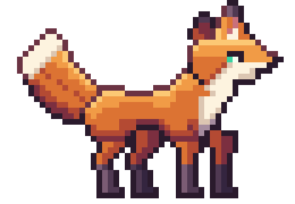 | 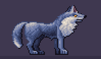 | 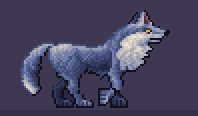 | 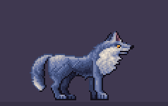 |
| | 60 frames | 32 frames | 40 frames, a lunge and a bite |

The first image shows the measured cut from `body_parts.py`. The second shows the animation rig at rest
and in a walk pose, with matching colours for the parts in both panels.

<p>
  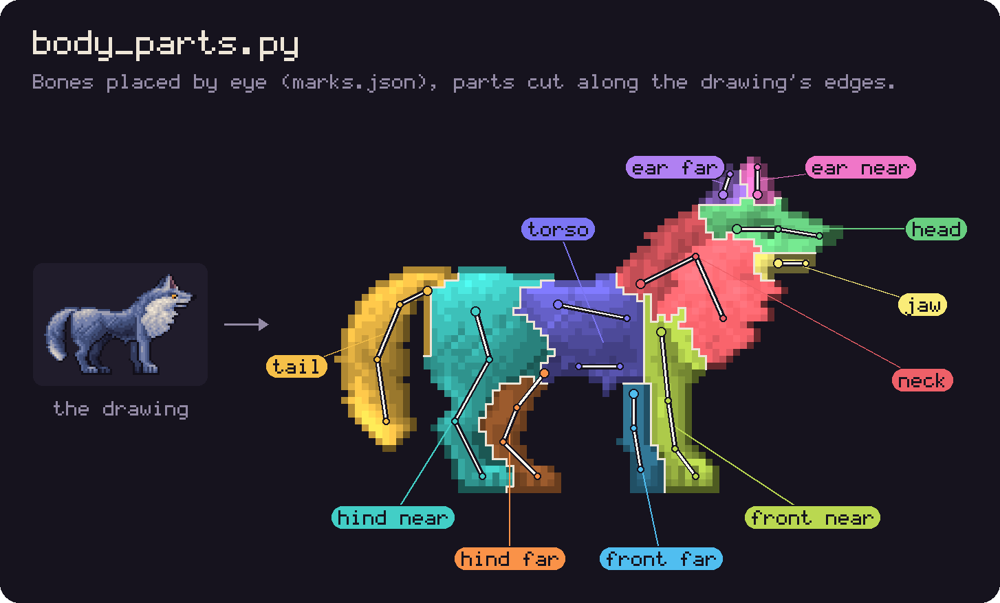
</p>
<p>
  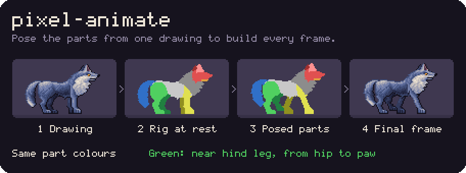
</p>

[Watch the rig and the animation check in action](../docs/img/gallery/workflow.gif).

### Bird (`bird`)

A flier. Frame 86x69. Its wings and head use drawn keys (`bird_wings.py`, `bird_heads.py`).

| the drawing | idle | move | attack |
|:---:|:---:|:---:|:---:|
| 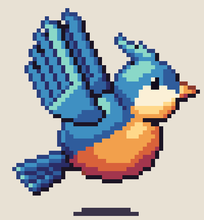 | 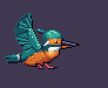 | 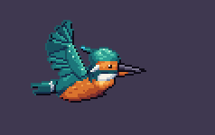 | 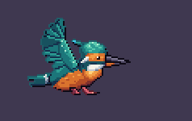 |
| | 72 frames | 32 frames | 54 frames, a dive strike |

### Lizard (`lizard`)

A low walker with a tongue strike. Frame 113x40. Its legs have their own module (`lizard_legs.py`).

| the drawing | idle | move | attack |
|:---:|:---:|:---:|:---:|
| 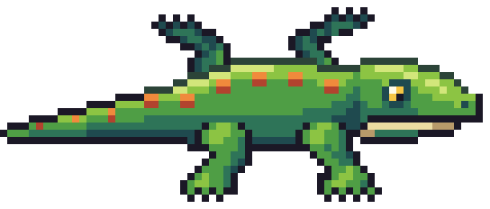 | 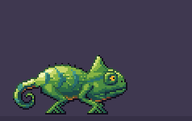 | 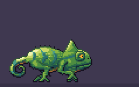 |  |
| | 60 frames | 32 frames | 34 frames, a tongue strike |

### Checking and rebuilding them

Each creature's full check command is at the end of its `animate.py` docstring; the wolf's is spelled out, option by
option, in [docs/usage.md](../docs/usage.md#the-showcase-creatures). All three print `0 fault(s)`.

```sh
python examples/showcase/beast/animate.py        # rebuild one creature's strips and its check/ files
python examples/showcase/make_showcase.py        # check all three, then redraw docs/img/hero.gif, check.png, parts.png
python examples/showcase/make_gallery.py         # redraw docs/img/gallery/, including workflow.gif
```

### What the check catches on them

[`make_gallery.py`](showcase/make_gallery.py) breaks the wolf's frames four ways and prints what the check says to
each:

<p>
  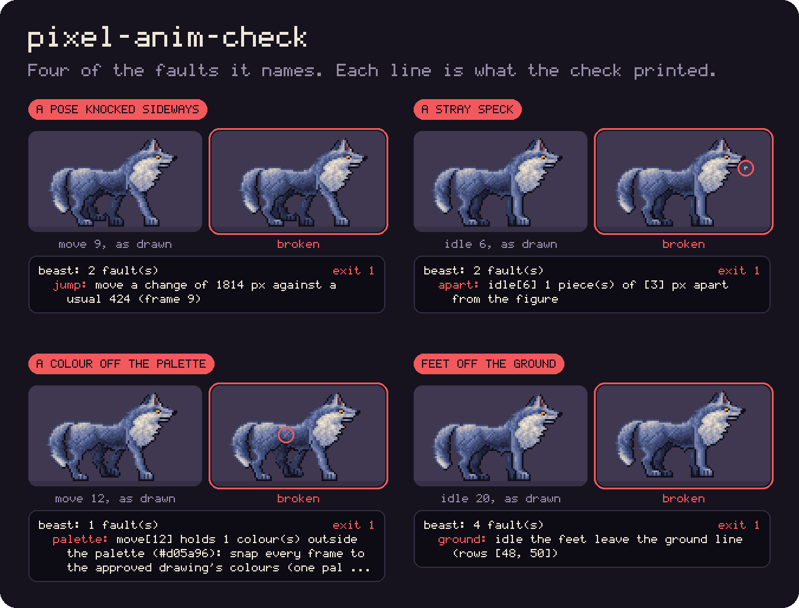
</p>

<p>
  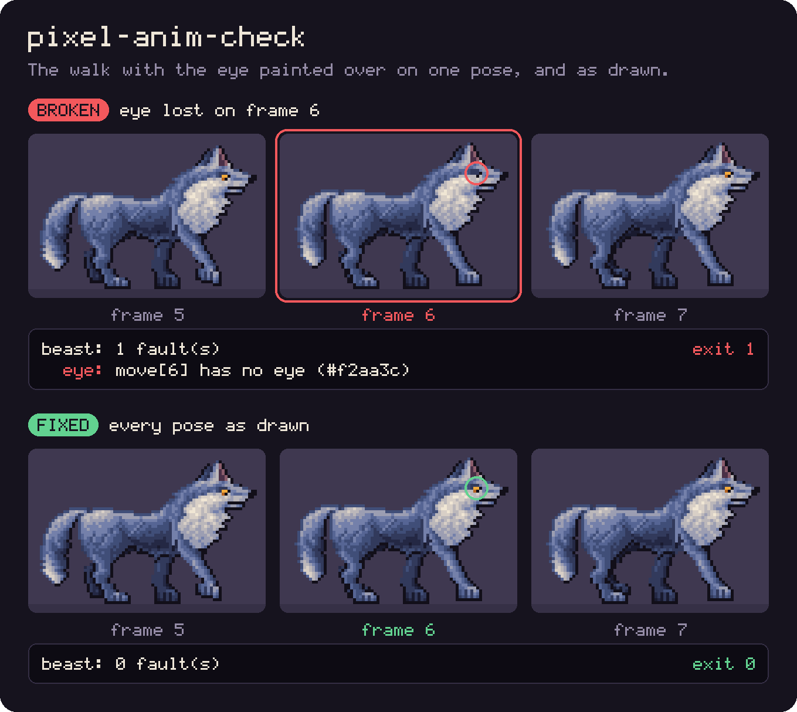
</p>
